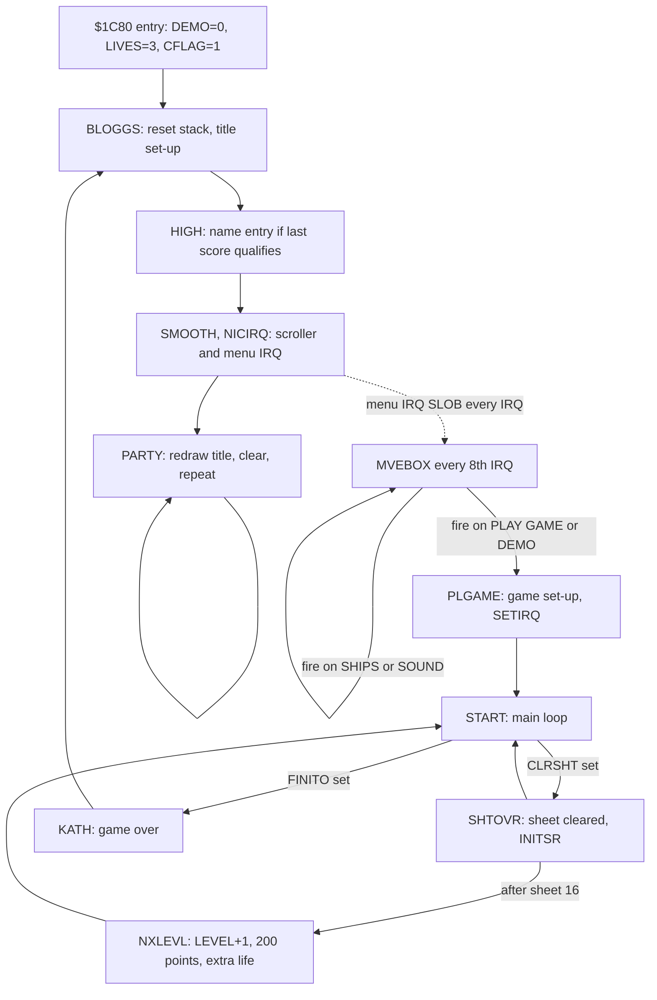
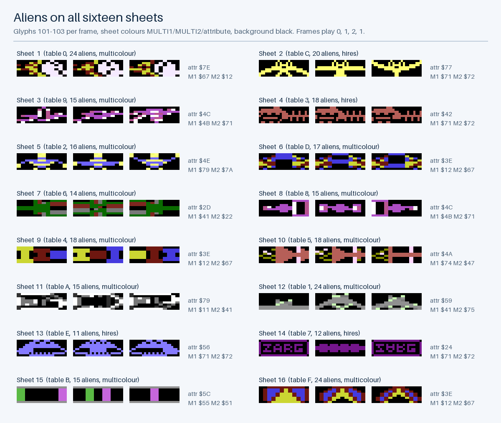
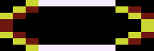
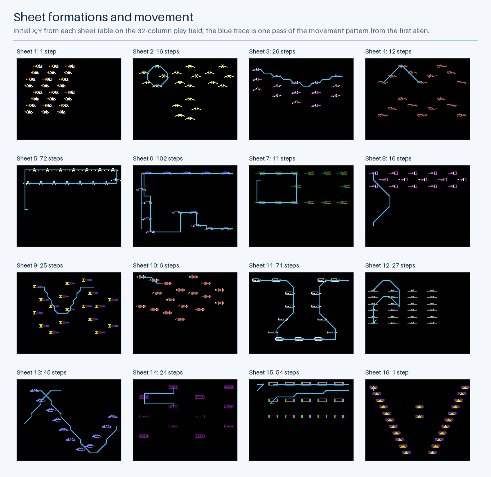
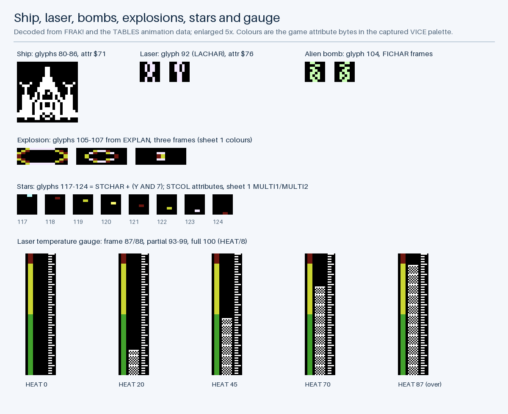
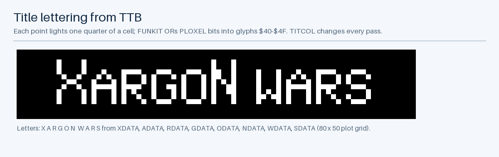
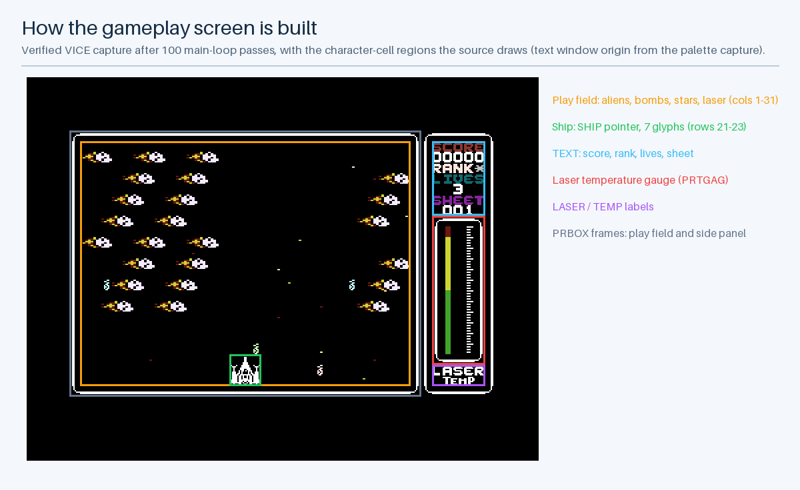
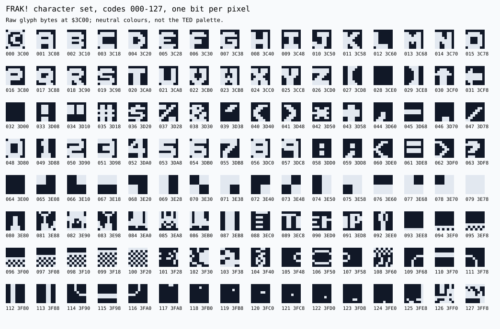

# Xargon Wars C16 – Codebase Analysis

## Purpose, Scope, and Evidence

This document explains how the surviving Xargon Wars implementation works, so that it can be studied, modified, and used as a specification for new versions on other platforms. It follows the shape of my Dorks Dilemma and Tycoon Tex analyses, but everything here was worked out from Xargon Wars' own disk sources, assembled bytes, running game, and packaging.

It describes the **source revision** that the default build reproduces and that the original `OBJ` listing records. Where I call something source behaviour, it comes from the instructions or data, not from comments alone. Comments that disagree with the code are pointed out. Probe results come from [rule-probes.json](docs/analysis/rule-probes.json), which records controlled VICE runs of the original routines. Proposals and inferences are labelled as such. The emulator evidence covers start-up, gameplay entry, and the focused probes. It doesn't cover a complete play-through.

Use this alongside the [generated code reference](docs/analysis/CODE_REFERENCE.md), the [machine-readable index](docs/analysis/codebase-index.json), the [asset data](docs/analysis/asset-data.json), and the [porting guide](docs/PORTING_GUIDE.md). The recovery story is in [Dorks Dilemma C16](https://github.com/anthonyjclarke/Dorks_Dilemma_C16), and the [validation document](docs/SOURCE_AND_VALIDATION.md) records the restoration evidence.

---

## Game and Verified Baseline

Xargon Wars is a single-screen shoot-'em-up for the Commodore 16 and Plus/4. The player's ship sits at the bottom of a 31-column play field and can only move left and right. It fires one laser bolt at a time at a formation of up to 24 aliens. The aliens march around the screen on a looping pattern and drop bombs. Firing heats the laser, and if it overheats it stops working until it cools. There are 16 sheets, each with its own aliens, colours, formation, pattern and speeds. Clearing all 16 completes a level and starts the sheets again, faster.

| Property                | Source-build baseline    |
|:------------------------|:-------------------------|
| PRG load address        | `$1010` / 4112           |
| Execution entry         | `$1C80` / 7296           |
| Complete PRG            | 12,274 bytes             |
| Sheet tables            | 2,802 bytes              |
| Program code and data   | 7,782 bytes              |
| Object-listing bytes    | 10,747, zero differences |
| Verified emulator model | PAL C16, 16 KB RAM       |
| Running PRG entry       | BASIC `1 SYS7296`        |

The PRG starts with the sheet tables, not with BASIC text, so the rebuild is started with a monitor jump to `$1C80`. The running version I have is a post-run memory snapshot of a revision with two small differences in `ALIENS` (see [Revision Differences](#revision-differences)).

---

## Repository and Source Organization

The source disk holds 60 sequential source files. `ULTRA` is the root, and its `.LIB` lines pull in 50 other modules in a fixed order. The order matters, because each fixed-origin block (`*=$1010`, `*=$1C80`) gathers everything listed after it. `VARS` and `EXTRA-MEMORY` come first and only reserve memory. `SHTABLE` and the 16 `SHEET` files fill `$1010–$1B01`. Everything else is code and data from `$1C80` upwards. The full assembly order and per-module byte counts are in the [code reference](docs/analysis/CODE_REFERENCE.md#modules-in-assembly-order).

### Module Responsibilities

| Module                | Responsibility                              |
|:----------------------|:--------------------------------------------|
| `ULTRA`               | Entry at `$1C80`, menu variables            |
| `VARS`                | Zero page `$02–$2D`, page 3 `$033C–$03B2`   |
| `EXTRA-MEMORY`        | Alien, bomb, star and scroll tables         |
| `SHTABLE`, `SHEETn`   | Per-sheet parameters, patterns, glyphs      |
| `MAIN-VARS`           | Tuning constants and star tables            |
| `MAGNIFICENT`         | Title entry `BLOGGS` and loop `PARTY`       |
| `TITLE-WORKS`         | Menu, boxes, big title, menu interrupt      |
| `HIGH-STUFF`          | High-score table, rank lookup, name entry   |
| `SMOOTH-SCROLL`       | Title scroller using glyphs 80–98           |
| `PLAY-GAME`           | Game set-up `PLGAME` and main loop `START`  |
| `IRQ`                 | Raster and timer-2 interrupt services       |
| `SETSHEET`            | Sheet set-up, sheet clear, level advance    |
| `ALIENS`              | Alien movement and drawing                  |
| `ANIMATE`             | Per-frame glyph replacement                 |
| `KILLER`              | Hit detection and explosion counters        |
| `BOMBS`               | Bomb creation, movement and drawing         |
| `SHIP`                | Ship movement, laser firing and drawing     |
| `GAUGE`               | Laser temperature display                   |
| `STARS`               | Four-speed star field                       |
| `SCREEN`              | Play screen layout and side-panel effects   |
| `SCORE-ROUTINES`      | Score digits on screen, extra lives         |
| `RANK-MASTER`         | Live rank display                           |
| `DEATH-MARCH`         | Ship death animation and life loss          |
| `GAME-OVER`           | Game-over effects, delay and clear routines |
| `SOUND`, `TUNE`       | Sound effects and the two tunes             |
| `JOYSTIK`, `KEY-SCAN` | Input, demo movement                        |
| `JO/KE SELECTION`     | J/K selection and its on-screen label       |
| `STARTER`             | Star start-up and "GET READY" countdown     |
| `UTILS`, `TABLES`     | Screen addressing, random numbers, tables   |

---

## Runtime Architecture and Game States



There are three separate execution contexts, and a port needs to keep them apart:

- **Foreground.** The title loop `PARTY`, and in play the main loop `START`.
- **Raster interrupt.** Once per frame at line 210 during play. It does all the drawing.
- **Timer-2 interrupt.** Game logic: input, ship, laser, stars, animation, heat and tune.

On the title page, a separate interrupt handler, `SLOB`, runs the menu.

### Entry and Persistent Choices

The bytes at `$1C80` run only once per load: `LDA #0 / STA DEMO`, then `LIVES = 3`, `CFLAG = 1` (sound on), and `JMP BLOGGS`. `LIVES`, `CFLAG`, `DEMO`, `SHEETN` and `JOYSEL` sit right after that jump, inside the code region, so they survive `CLPAG3`. That's why the menu settings persist between games. `JOYSEL` starts at 0, which selects the keyboard.

### Title and Menu

`BLOGGS` ($30BC) resets the stack with `LDX #$FE / TXS`, silences the TED, clears page 3 and part of zero page, and runs `SETUP`, `SESOUN` and `SELIVE`. It then switches multicolour off for the title, fills the screen, and prints the high-score table, the menu and the J/K label. Next it draws the boxes, the big title and the scroller. If the game just ended, it calls `HIGH`, which handles name entry. Finally `NICIRQ` points the IRQ vector at `SLOB`.

`SLOB` ($347A) saves `HITX`, `HITY`, `XS` and `YS`, which `MVEBOX` and the foreground drawing routines share. Every eighth interrupt it calls `MVEBOX`. On every interrupt it calls `CHSEL` and `FLTHIN` (the flashing colours, then the scroller after a raster wait). `MVEBOX` reads input with `REDJOS`. Up and down move the box, and fire calls `WHJUMP` with the box index.

`WHJUMP` ($3448) is a computed branch. It writes `ADD+1` and then `BRAN+1`, so that `BNE BRAN` lands on one of four `JMP` instructions: `STGME`, `CLIVES`, `CSOUND` or `CDEMO`.

**PLAY GAME and DEMO MODE call `PLGAME` from inside the interrupt handler and never return from it.** The interrupt frame and the `SLOB`, `MVEBOX` and `WHJUMP` return addresses stay on the stack for the whole game. The gameplay check found `SP = $EB` at `START`. Only `BLOGGS` resets the stack, at the end of the game. `PLGAME` runs with interrupts disabled until `NORIRQ` executes `CLI`.

### Game and Sheet Set-up

`PLGAME` ($255D) does the following, in order:

1. Restores the normal KERNAL IRQ.
2. Copies back the 160 glyph bytes that the scroller borrowed (`SAVECH` → `$3E80`).
3. Fills the star table with `$FF`, clears page 3, and places the ship at `SHIPST = $0F57`.
4. Copies `LIVES` into `GLIVES`. In demo mode it also picks a random sheet from 0 to 7 using `TED+4 AND 7`.
5. Calls `SETUP`, `INSTAR`, `SETSCR` and `INITSR`.
6. Stops all stars, installs `SERV` with `SETIRQ`, and runs the `NICSTR` countdown with firing disabled.
7. Sets `PLAYIN = 1` and enters `START`.

`INITSR` ($2A4A) maps the play-order sheet number to a table entry through `CONSHT`. It then copies the entry's 15 fields into variables and TED registers, applies `LEVINC`, and copies the formation into the `ALIENS` table.

---

## Memory Map and State Representation

| Range         | Content                                      |
|:--------------|:---------------------------------------------|
| `$0002–$002D` | Zero-page pointers, input flags, temporaries |
| `$033C–$03B2` | Page-3 game state (119 bytes)                |
| `$0400–$045F` | `ALIENS`: 32 × (X, Y, pattern index)         |
| `$0560–$05BF` | `BOMBTB`, `BOMBPR`, `BOMBCL`: 16 bombs each  |
| `$05C0–$05DF` | `STARTB`: 16 stars × (X, Y)                  |
| `$05E0–$063F` | `ONTBL`: star draw list, 3 bytes per entry   |
| `$0640–$06DF` | `SAVECH`: saved glyphs (scroller or death)   |
| `$06E0–$075F` | `ALICLS`, `ALIPRT`: alien draw lists         |
| `$0800–$0BE7` | Colour RAM                                   |
| `$0C00–$0FE7` | Screen RAM, which also holds score and lives |
| `$1010–$1B01` | `SHTABLE` and the 16 sheets                  |
| `$1C00–$1C7F` | Tune table (`MUSIC/CODE`)                    |
| `$1C80–$3AE5` | Code, text and in-code variables             |
| `$3C00–$3FFF` | Character set (`FRAK!`), partly rewritten    |

`CLPAG3` clears `$033C–$03FF` and `$02–$42`. That's more than `VARS` declares in zero page, and it runs at the start of every title and every game.

### Coordinates Are Screen Cells

All game objects use character-cell coordinates on the 40×25 screen. `RUSTIC` and `XY` both turn X,Y into screen addresses through the 25-entry `SCRPTR` table. `XY` also sets the matching colour pointer (screen − `$0400`). `RUSTIC` exists because, in the source's words, it's "UNKNOWN AS TO WHETHER THE 'XY' ROUTINE WILL BE BEING USED IN THE IRQ". The two routines use different zero-page results (`SCLO/SCHI` and `SL/SH`), so one context can't corrupt the other's pointer.

### Important State Groups

| Group          | Variables                                     |
|:---------------|:----------------------------------------------|
| Input          | `JLEFT` to `JFIRE`, `JMOVE`                   |
| Ship and laser | `SHIP`, `NEWX`, `FIRE`, `BULX/Y`, `HEAT`      |
| Alien timing   | `MOVECT`/`MVESPD`, `ANICNT`/`ANISPD`, `FRAME` |
| Bomb timing    | `BERMB`/`FRESPD`, `CLOT`/`BOMSPD`             |
| Draw handshake | `PRAL`, `CLAL`, `PRBO`, `CLBO`, `BON`, `BOFF` |
| Progress       | `SHEETN`, `NUMHIT`, `NUMALI`, `LEVEL`         |
| Life and end   | `GLIVES`, `DEAD`, `DEATH`, `DCOUNT`, `FINITO` |
| Sound          | `WHSND`, `SHITSO`, `PLAYTU`, `TNOTE`          |

The score itself is never held in RAM variables. The five ASCII digits on screen at `$0C72` are the score, and `$0CEC` is the lives digit. `SCORE`, `XTRALI`, `RANKER` and `DEATH-MARCH` all read and write those screen cells.

---

## Interrupt Scheduling and Timing

`SETIRQ` enables the raster interrupt at line 210 and TED timer 2, which it loads with `$3800`. `SERV` reads `$FF09` and writes the same value back, which acknowledges every pending source. It then tests bit 4: if timer 2 is pending it runs the timer work, and otherwise the raster work. If both are pending at the same entry, both are acknowledged but only the timer work runs.

| Raster service (drawing)      | Timer-2 service (logic)     |
|:------------------------------|:----------------------------|
| `PRSTAR` stars                | `MVSTAR` move stars         |
| `CLALIN` erase aliens         | `GATUFF` heat cool-down     |
| `CLBOMB` erase bombs          | `ANICHR` glyph animation    |
| `SOUND` effect updates        | `REDJOS` input              |
| `PRALIN` draw aliens          | `MVEBUL` move laser         |
| `PRBOMB` draw bombs, hit test | `MVSHIP` ship and fire      |
| `PRBLET` draw laser, hit test | `HEMOGL` side-panel colours |
| `PRGAGE` gauge                | `TUNEUP` tune               |
| `PRSHIP` ship, hit test       | reload timer `$3800`        |
| `UPDEAD` death sequence       |                             |

The [interrupt probe](docs/analysis/rule-probes.json) recorded 12 consecutive frames in VICE. Raster entries averaged 35,562 clock units apart and timer-2 entries 35,497. Each timer entry came about 5,900 to 8,000 units before the next raster entry. In that sample, then, the timer work ran once per frame, just ahead of the drawing. The source doesn't explain why the two stay in step, and I haven't established the mechanism. A port should treat "once per frame, logic before drawing" as the observed behaviour, not as a guarantee in the code.

### Foreground Pacing

`START` ($25D6) is a busy loop. Each pass runs:

1. `RANKER`.
2. A fixed delay (`LDX #$14`, then 5,120 inner iterations).
3. Alien movement, every `MVESPD` passes.
4. A new bomb, every `FRESPD` passes.
5. Bomb movement, every `BOMSPD` passes.
6. Checks for game over and sheet clear.

The [main-loop probe](docs/analysis/rule-probes.json) measured 8 passes early on sheet 1, averaging 114,813 clock units, or about 3.2 frames per pass. Pass length depends on the interrupt load, so alien and bomb speed is tied to that loop rather than to the frame rate.

### Concurrency Contracts

The foreground and interrupts communicate through flags, not locks:

- `MVEALL` (foreground) builds `ALIPRT` and `ALICLS`, then sets `PRAL = CLAL = 1`. The raster service erases with `CLALIN`, which clears `CLAL`, and redraws with `PRALIN`. `PRAL` is never cleared there, because the source says the aliens must keep being redrawn "OTHERWISE THEY GET RUBBED OUT BY THE STARS".
- `MVEBMB` copies `BOMBPR` to `BOMBCL`, rebuilds `BOMBPR`, then sets `PRBO = CLBO = 1`.
- `MVSTAR` (timer) builds `ONTBL` and sets `CHANGE = 1` for `PRSTAR`.
- `PRBLET` waits until the aliens aren't being erased and are on screen before it tests the laser cell.
- `SHTOVR` (foreground) spins on `SHITSO` and then on `DEAD`, which only the interrupts change, before it clears the screen with `SEI`/`CLI` around `CLRDIS`.

Because collisions are tested against what's currently on screen, the order of the raster calls is part of the game rules. Aliens are erased, then sound runs, then aliens are drawn, then bombs, then the laser, then the ship.

---

## TED Display Model and Hardware Coupling

`SETUP` selects RAM characters by clearing bit 2 of `$FF12`, sets the character base with `$FF13 = $3C`, and turns on multicolour mode by setting bit 4 of `$FF07`. The `$3C` value places the set at `$3C00`, although the source comment says `$3800`. The title page clears multicolour again. Screen RAM is at `$0C00` and colour RAM at `$0800`, which are the C16 defaults.

In multicolour mode, a cell is drawn in multicolour only when bit 3 of its attribute is set. Each pixel pair then selects one of four pens: `00` is the background `$FF15` (black), `01` is `$FF16` (`MULTI1`), `10` is `$FF17` (`MULTI2`), and `11` is the cell's own colour and luminance (attribute AND `$77`). Each sheet sets `MULTI1`, `MULTI2` and the alien attribute, which is why the same glyph slots look different on every sheet. Four sheets (2, 4, 13 and 14) use hires aliens. Stars use attributes `$7B`–`$7F`, so they're multicolour too, and their colours follow the sheet's `MULTI1`/`MULTI2`.

Other hardware links:

- Random values come from TED timer bytes (`TED+2`, `TED+4`, `TED`) as well as the `RANDOM` routine.
- `SYNC` and the title scroller poll the raster bit in `$FF1C`.
- `SETUP` disables Shift/Commodore case switching through the KERNAL.

---

## Sheets: Level Data and Formations

Each of the 16 entries in `SHTABLE` is 16 bytes:

| Offset | Field                                   |
|:-------|:----------------------------------------|
| 0      | Pattern length (`MVELEN`)               |
| 1–2    | Pattern address                         |
| 3      | Animation speed, timer ticks per frame  |
| 4      | Firing speed, main passes per new bomb  |
| 5–6    | `MULTI1`, `MULTI2` → `$FF16`, `$FF17`   |
| 7      | Alien attribute (`ATTCOL`)              |
| 8      | Movement speed, main passes per step    |
| 9–10   | Alien glyph data (3 frames × 24 bytes)  |
| 11–12  | Initial positions (X, Y, pattern index) |
| 13     | Number of aliens                        |
| 14     | Bomb speed, main passes per bomb step   |
| 15     | Spare (always 0)                        |

Play order isn't table order. `CONSHT` gives 0, 12, 9, 3, 2, 13, 6, 8, 4, 5, 10, 1, 14, 7, 11, 15, so the first sheet played is table entry 0 and the second is entry `$C`.

| Sheet | Table | Aliens | Pattern | Move | Fire | Bomb | Anim | Mode  |
|------:|:------|-------:|--------:|-----:|-----:|-----:|-----:|:------|
|     1 | `0`   |     24 |       1 |    4 |    8 |    4 |    8 | multi |
|     2 | `C`   |     20 |      16 |    3 |    4 |    2 |   12 | hires |
|     3 | `9`   |     15 |      26 |    8 |    4 |    4 |    8 | multi |
|     4 | `3`   |     18 |      12 |    4 |    8 |    4 |    4 | hires |
|     5 | `2`   |     16 |      72 |    4 |    4 |    3 |    4 | multi |
|     6 | `D`   |     17 |     102 |    8 |    4 |    4 |    4 | multi |
|     7 | `6`   |     14 |      41 |    8 |    4 |    4 |    4 | multi |
|     8 | `8`   |     15 |      16 |    8 |    4 |    4 |    8 | multi |
|     9 | `4`   |     18 |      25 |    4 |    4 |    4 |   10 | multi |
|    10 | `5`   |     18 |       6 |    4 |    4 |    4 |   10 | multi |
|    11 | `A`   |     15 |      71 |    6 |    4 |    4 |   15 | multi |
|    12 | `1`   |     24 |      27 |    4 |    4 |    2 |   14 | multi |
|    13 | `E`   |     11 |      45 |    3 |    4 |    4 |   16 | hires |
|    14 | `7`   |     12 |      24 |    8 |    4 |    4 |   10 | hires |
|    15 | `B`   |     15 |      54 |    6 |    4 |    4 |    8 | multi |
|    16 | `F`   |     24 |       1 |    3 |    2 |    2 |   10 | multi |

Lower numbers are faster, because each value counts loop passes or timer ticks between events.

### Movement Patterns

A pattern is a list of direction codes 0–8. `XTBL` and `YTBL` turn each code into a step: 0 is up, 1 up-right, 2 right, 3 down-right, 4 down, 5 down-left, 6 left, 7 up-left, and 8 stands still. Every alien keeps its own index into the shared pattern, in the third byte of its `ALIENS` entry. `MVEALL` increments that index first and wraps it to 0 at `MVELEN`, then applies the step. So an alien that starts at index 0 first moves using entry 1. Several sheets start their aliens at different indexes, which makes them move out of phase.

Aliens wrap around the play field. An X of 0 becomes 29, an X of 30 or more becomes 1, a Y of 0 becomes 23 and a Y of 24 or more becomes 1. An alien occupies three cells, from X to X+2. Sheets 1 and 16 have one-step patterns: the whole formation slides right or down and wraps.

---

## Player Ship, Laser, and Heat

The ship is seven glyphs, 80–86, drawn at `SHIP` + `SHDAY` offsets. One glyph sits at +1, three at +40 to +42 and three at +80 to +82, so it spans rows 21–23. `SHIP` runs from `$0F49` to `$0F65`, which is columns 1 to 29. `MVSHIP` (timer) moves it one column per timer tick while left or right is held, and sets `CSHIP` so that `PRSHIP` (raster) erases the old ship and redraws it at `NEWX`. The ship can't move up or down, even though the input routines read up and down.

Firing (`MVSHIP` → `HUMM`) only happens when all of these are true:

- `JFIRE` bit 7 is set;
- `JFIRE` differs from `OLDFIR`;
- `DNTFIR` is clear;
- no bolt is in flight (`FIRE = 0`);
- the laser isn't overheated (`NFIRE = 0`).

The input flags are shift registers: every read does `ROR` on each flag with the new state. A held button therefore keeps changing `JFIRE` until eight `1`s have shifted in. As far as I can tell from the code (I haven't probed it), holding fire gives a few shots in the first eight timer ticks and then stops until the button is released.

A shot adds 8 to `HEAT`, starts the laser sound, and puts the bolt at column `SHIP − $47` (the ship's centre), row 20. `MVEBUL` moves it up one row every `BSPEED = 3` timer ticks, and it vanishes at row 0. `GATUFF` lowers `HEAT` by one every 16 timer ticks (`VARIAB`). At `HEAT ≥ $57` (87), `NFIRE` is set and the overheat sound starts. Firing comes back only when `HEAT < $31` (49). That hysteresis is the "red" and "green" zone on the instruction card. `PRGAGE` draws `HEAT / 8` full cells (glyph 100) from row 20 upwards, topped by a partial glyph 93–99. While the laser is overheated, `NFIRE` doubles as a flashing colour counter for the gauge frame.

---

## Aliens: Movement, Drawing, and Explosions

`MVEALL` (foreground) handles every alien in two steps. First, `BUMP` copies the last frame's `ALIPRT` to `ALICLS` and strips the flag bits from each high byte. Then it moves each live alien and writes its new screen address to `ALIPRT`. In each stored high byte, bit 7 is set if the alien is exploding. An entry with X = `$FF` is dead and skipped. `$FF $FF` ends the list.

`ALILOP` (raster) walks a list through the self-modifying pointers `SLFMD1`/`SLFMD2`. In print mode it draws three glyphs: 101–103 for an alien, or 105–107 if bit 7 is set. It then writes `ATTCOL` to the matching colour cells. In clear mode it writes three spaces and leaves the colours alone.

`ANICHR` (timer) changes the glyphs themselves, not the screen codes. Every `ANISPD` ticks it copies frame `TIME24[FRAME]` (0, 24, 48, 24: a 0-1-2-1 cycle) of the sheet's glyph data into glyphs 101–103. It copies the matching `EXPLAN` frame into 105–107. At each step it also switches the bomb glyph 104 (`FICHAR`) and the laser glyph 92 (`LACHAR`) between their two frames, using `FRAME AND 1`. Every alien and explosion on screen animates together.

When an alien is hit, `ALIHIT` sets bit 7 of its Y and clears its explosion counter. `UPEXPL` (foreground, after each movement step) advances a 2-bit counter in bits 5–6 of the X byte. When the counter wraps to 0, it sets the whole entry to `$FF`. An explosion therefore lasts three movement steps and keeps moving with the formation. Its look depends on the global animation frame, not on how long ago the alien was hit.

### Revision Differences

The running PRG lacks the `GIDO` mask (`LDA IH / AND #$F / STA IH`, `ALIENS:150–152`), and `BUMP` there uses `AND #$7F` instead of `AND #$0F` (`ALIENS:227`). `RUSTIC` builds every screen address from `SCRPTR`, which runs from `$0C00` to `$0FC0`, plus a column of at most 31. So every stored high byte is `$0C`–`$0F`, with or without bit 7. For those values the two revisions write to the same screen and colour cells. I've reasoned that from the code and haven't probed it. A derivative that changes the screen base or the address format would need to choose between the masks deliberately.

---

## Bombs

There are 16 bomb slots, stored as X,Y pairs in `BOMBTB`. Every `FRESPD` main-loop passes, `NEWBMB` takes the first free slot and makes up to `NTRIES = 24` attempts to find a random live alien (`RND+1 AND $1F < NUMALI`, with bit 7 of Y clear). It drops a bomb from that alien's centre column, at the alien's own row. Every `BOMSPD` passes, `MVEBMB` moves every bomb down a row and removes any that reach row 24. `PRBOMB` (raster) draws glyph 104 with a random colour, chosen with `TED AND 7`, never black. It doesn't draw over an alien cell (101–107), and it sets `DEAD` if the cell holds glyph 80–90. The laser only tests for glyphs 101–103, so it passes through bombs.

---

## Collision Model and Character-Code Contracts

Every collision is a test of what glyph is on screen at that moment, so glyph numbers are part of the rules.

| Codes   | Meaning                      | Tested by          |
|:--------|:-----------------------------|:-------------------|
| 32      | Empty cell                   | Stars, everything  |
| 64–79   | Title quarter-block glyphs   | Title only         |
| 80–86   | Ship                         | `PRBOMB` (80–90)   |
| 87, 88  | Gauge frame                  | –                  |
| 89–91   | `TEMP` label                 | `PRBOMB` (80–90)   |
| 92      | Laser bolt (animated)        | –                  |
| 93–100  | Gauge partial and full cells | –                  |
| 101–103 | Alien (animated per sheet)   | `CHKBUL`, `PRSHIP` |
| 104     | Bomb (animated)              | `PRSHIP` (101–107) |
| 105–107 | Explosion (animated)         | `PRSHIP`, `PRBOMB` |
| 109–116 | Box frame pieces             | –                  |
| 117–124 | Star, 8 vertical positions   | `PRSTAR` (117–124) |

**Laser hits.** `PRBLET` checks the cell the bolt is moving into and the cell below it. If either holds 101–103, `ALIHIT` subtracts `(code AND 3) − 1` from the bolt's X to find the alien's left column, adds one to Y if the hit was in the lower cell, and searches `ALIENS` for an exact X,Y match. A dead alien's Y has bit 7 set, so it can't match. The bolt is removed whether or not a match is found.

**Ship deaths.** `PRSHIP` sets `DEAD` if any cell it's about to overwrite holds 101–107: an alien, a bomb or an explosion. `PRBOMB` sets `DEAD` if a bomb lands on 80–90. Stars draw only onto empty cells or other star cells, so they never hide anything.

---

## Scoring, Extra Lives, Rank, and High Scores

`SCORE` runs from `ALIHIT`, inside the raster interrupt. It calls `XTRALI` first and only then adds the points. The [probes](docs/analysis/rule-probes.json) confirmed these results:

| Rule              | Probe result                                  |
|:------------------|:----------------------------------------------|
| Points, level 0   | sheets 1–8: 1–8 points; 9–16: 10              |
| Points, level ≥ 1 | always 10                                     |
| Extra life        | 999 → 1000 on one hit, life on the next hit   |
| Overflow          | 99,999 + 10 → `00009`, stray `$01` at `$0D71` |

`ADDSCR` adds to one ASCII digit and carries left until no carry remains. Past the leftmost digit, `Y` wraps to `$FF`, and `STA SCRPOS,Y` writes to `SCRPOS + 255`. That's row 9, column 9 of the play field, which gets glyph 1. `XTRALI` compares the thousands digit with `XTROB` and awards a life whenever it changes. A thousands digit that wraps from 9 to 0 also counts. Because the check runs before the add, crossing 1,000 doesn't pay out until the next scoring hit. The 200-point level bonus doesn't call `XTRALI`. `ADDLIF` caps `GLIVES` at 9 and increments the lives digit on screen.

The instruction card's "200 bonus points at level completion" and "extra life every 1,000 points and at level completion" match `NXLEVL` and `XTRALI`. Level here means all 16 sheets, not one sheet.

**Rank.** `RANKER` runs on every main-loop pass. It copies the on-screen score to `SCRBUF` and calls `HIGH`. Because `PLAYIN = 1`, `HIGH` returns the table position without changing anything. The rank cell shows positions 1–6, or `*` if the score isn't in the table.

**High scores.** `HISTBL` has six 14-byte records: five ASCII digits, two zero bytes, a six-character name and a zero. A seventh dummy record follows. After a game, `HIGH` (with `PLAYIN = 0`) moves the lower records down, inserts the score, and runs name entry. Up and down change the letter, left and right move between the six positions, and fire finishes. The table is in RAM only and is lost when the machine is switched off.

---

## Progression and Difficulty

A sheet is cleared when `NUMHIT` reaches `NUMALI`. `SHTOVR` then:

1. waits for the explosion sound and any death to finish;
2. clears the play field;
3. plays the short jingle, with `TNOTE = $FF`;
4. flashes "XARGON nn DESTROYED" for 200 short delays;
5. increments `SHEETN` and the BCD `DECSHT`;
6. after sheet 16, calls `NXLEVL`;
7. updates the sheet number on screen, and calls `INITSR`.

`NXLEVL` resets `SHEETN`, plays the long tune (`TNOTE = 9`), increments `LEVEL`, flashes the border, adds 200 points, adds a life, and busy-waits for the tune to end.

`LEVINC` subtracts `LEVEL` from each sheet's firing, movement and bomb speeds and stops at a minimum of 1. The [probe](docs/analysis/rule-probes.json) confirmed that starting from 8, 4 and 4, level 1 gives 7, 3, 3 and level 4 gives 4, 1, 1. Because `INITSR` reloads the table values for every sheet, the reduction doesn't build up from sheet to sheet. It depends only on `LEVEL`. Alien count, pattern and animation speed never change.

---

## Death, Game Over, and Demo

`DEAD` is set by a collision. `UPDEAD` (raster) runs the death sequence:

1. On the first frame it saves the ship glyphs to `SAVECH` and starts the noise explosion.
2. It then runs 66 steps, each lasting five raster interrupts. That's 330 frames, or about 6.6 seconds at PAL's 50 Hz, worked out from the source rather than measured.
3. During those steps it cycles the ship's colour, fades the volume, and scrambles glyphs 80–86 with timer bits. It flashes them for the first 46 steps, then erodes them.
4. `DEADRI` stops all sound, clears `DEAD` and `HEAT`, restores the glyphs, and decrements `GLIVES` and the lives digit.

When `GLIVES` reaches 0, `DEADRI` copies the score into `SCRBUF` and sets `FINITO`. In demo mode it copies `0` digits instead, so a demo never makes the high-score table.

`KATH` (main loop) clears `DEMO` and `PLAYIN`, restores the KERNAL IRQ, runs the curtain and "GAME OVER" effects, and jumps to `BLOGGS`.

**Demo mode.** `CDEMO` sets `DEMO = 1` and `DEMLEN = 1`, then enters `PLGAME`. `REDJOS` then hands over to `RANMVE`, which picks left or right (`MVEPAT`) for 2–7 timer ticks at a time and always holds fire. The demo starts on a random sheet from 1 to 8 and runs until it loses all its lives. Nothing in the input path ends it early.

---

## Input, Pause, and Sound

### Input

`REDJOS` returns nothing while `DEAD` is set, and it hands over to `RANMVE` in demo mode. If `JOYSEL` = 0 it calls `KEY`. Otherwise it writes `$FD` to `$FF08` and reads port 0. If nothing is pressed there, it tries `$FA` for port 1. The two ports put the fire bit in different places. To cope, `REDJOS` rewrites the opcode at `XTRCDE`: `LSR A` (`$4A`) for port 0 and `NOP` (`$EA`) for port 1, so that one `ROR JFIRE` serves both.

`KEY` scans five keys through `KEYIT`, which writes Y to `$FD30` and `$FF08` and ANDs the column mask with `$FF08`:

| Key    | Row (Y) | Mask (A) | Flag     |
|:-------|:--------|:---------|:---------|
| `ESC`  | `$BF`   | `$10`    | `JLEFT`  |
| `1`    | `$7F`   | `$01`    | `JRIGHT` |
| `F3`   | `$FE`   | `$40`    | `JUP`    |
| `HELP` | `$FE`   | `$08`    | `JDOWN`  |
| `F1`   | `$FE`   | `$10`    | `JFIRE`  |

**J/K selection.** `CHSEL` is meant to test `J` (mask `$04`) and `K` (mask `$20`) on row `$EF`, but it loads the row into X, and `KEYIT` reads Y. The [probe](docs/analysis/rule-probes.json) caught Y at `$80`, `$F7`, `$E1`, `$AD`, `$9D` and `$69` on successive calls. The scanned rows therefore change all the time. `J` and `K` only register when Y happens to include row 4, and other keys in the same column can trigger them too. I haven't tested this by hand. A faithful port should keep it, and a corrected derivative should say that it fixes it.

There is no pause key.

### Sound

The TED has two tone channels, and channel 2 can play noise. The game uses them like this:

| Effect         | Channel and method                          |
|:---------------|:--------------------------------------------|
| Laser shot     | Ch 1 tone, low byte −4 per frame, 40 frames |
| Overheat       | Ch 1, `ROL SOU1LO` each frame               |
| Alien hit      | Ch 2 noise, −14 per frame until it borrows  |
| Ship explosion | Ch 2 noise, volume down 1 every 5 frames    |
| Tunes          | Ch 2 tone, 3 bytes per note (timer service) |

Effects run only while `CFLAG` = 1. The source comment at `CSOUND` says "1 = SOUND OFF", but `TUNE`, `SOUND` and the menu label all treat 1 as on. The tune table at `$1C00` holds the eight-note sheet-clear jingle (notes 0–7) and the 31-note level tune (notes 10–40), each ending with `$FF`. Note 9 is never played. On the disk, `JINGLE1` and `JINGLE2` are C16 BASIC prototypes of the same two tunes. They use the same TED register values (computed as `1028 − n`) with longer lengths.

---

## Graphics: Glyphs, Frames, and Screen Assembly

All the graphics are 8×8 glyphs in the 128-character `FRAK!` set at `$3C00`. Some glyphs are rewritten while the game runs. The figures below are decoded deterministically from the exported bytes by [render_game_graphics.py](scripts/render_game_graphics.py). Colours use the palette captured from VICE 3.10 ([ted-palette.json](docs/analysis/graphics/ted-palette.json)), and the inputs and outputs are hashed in the [graphics manifest](docs/analysis/graphics/graphics-manifest.json).

### Aliens on Every Sheet



Each sheet's 72 bytes of glyph data hold three frames of three glyphs. They're shown with that sheet's `MULTI1`, `MULTI2` and attribute. Sheet 14's first frame spells "ZARG", a detail that only shows up once the data is decoded. The animation below shows sheet 1 in the game's 0-1-2-1 order. The GIF timing is illustrative: in the game a frame lasts `ANISPD` timer ticks.

 

### Formations and Patterns



Each panel places the sheet's aliens at their initial positions. It traces one pass of the movement pattern from the first alien, with the same wrap rules as `MVEALL`. The traces show where each formation travels, not the timing.

### Ship and Effects



The ship and the gauge use fixed glyphs. The laser and the bomb each alternate between two frames. Each star glyph has one lit pixel pair in a different row, and the star's Y position within its cell picks the glyph. The gauge examples show the fill at several `HEAT` values.

### Title Lettering



`FUNKIT` plots each letter's point list from `TTB` onto an 80×50 grid. Each point ORs one `PLOXEL` bit into the cell's glyph code, so glyphs `$40`–`$4F` are the 16 combinations of four quarter-blocks. A short `DELAY` between points makes the title draw itself on screen. The reconstruction matches the verified title screenshot.

### How the Screen Is Built



`SETSCR` fills the screen with spaces, frames the play field and the side panel with `PRBOX`, prints `TEXT` and draws the gauge. During play, every object is drawn by writing screen codes and colours into cells. There are no sprites, and nothing scrolls during play.

### Reference Atlases

The [one-bit](docs/analysis/font-hires.svg) and [two-bit](docs/analysis/font-multicolor.svg) atlases show every glyph of `FRAK!` with its code and address, in neutral index colours.

 The [alien glyph atlas](docs/analysis/alien-glyphs.svg) shows all 16 sheets' raw glyph data. [asset-data.json](docs/analysis/asset-data.json) has the raw bytes of the character set, the tune, every sheet entry, pattern, formation and glyph block, and the named tables.

---

## Text and Title Presentation

The menu, side-panel labels, high-score table and messages are stored as ASCII with `.BYTE` and converted to screen codes with `AND #$3F` when printed. `PRTTXT` prints a list of `X, Y, text, 0` records ending in `$FF`. It reads the list through self-modified operands, `PXL`, `PXL1` and `PXLL`, so `SETSCR` and `PRMENU` point it at `TEXT` or `MENTBL` first.

The title scroller in `SMOOTH-SCROLL` borrows glyphs 80–98 as a 152-pixel bitmap strip. `SMOOTH` first saves 160 bytes (glyphs 80–99) to `SAVECH`. Each call of `SCROLL` then shifts the strip left by one pixel. Every eighth call it copies in the glyph for the next character, at `$3C00 + code × 8`. The `× 8` is three `ASL A` instructions on an 8-bit ASCII code, which drops the top bits. So `A` (`$41`) lands on glyph 1, the screen-code `A`. That works for letters and space (handled separately), but a digit would show the wrong glyph, and the scroller text has none. `PLGAME` restores the borrowed glyphs before play. The flashing menu colours, high-score names and scroller row all come from `FLTHIN` in the menu interrupt.

---

## Original and Modern Development Tools

The disk shows the 1985 workflow. The source was assembled on a C64: there's an assembler (`ASM.C64`), the Commodore editor (`EDITOR`), the DOS 5.2 wedge and a fast loader, with `BOOT ALL` loading the editor and DOS. The C64 produced the MOS hex listing `OBJ`, and `SUPER-LOAD` on the C16 loaded such files. `SAVER` wrote the cassette auto-run loader, whose own listing is `OBJ.ANT`. The sound was tried out first in C16 BASIC (`JINGLE1`, `JINGLE2`, `MUSIC-MAKER`, `WASAL`). `HAK/SCREEN` and `HEXER` were test aids. [Dorks Dilemma's history](https://github.com/anthonyjclarke/Dorks_Dilemma_C16/blob/main/docs/DEVELOPMENT_HISTORY.md) describes the development setup.

The modern pipeline reads the D64 directly, converts the MOS syntax to ca65, assembles it at the original fixed addresses and checks it against `OBJ`. See [Build and Run](docs/BUILD_AND_RUN.md).

---

## Self-Modifying Code and Layout Dependencies

| Site                  | What changes and why                     |
|:----------------------|:-----------------------------------------|
| `PXL`, `PXL1`, `PXLL` | Text-list address for `PRTTXT`           |
| `SLFMD1`, `SLFMD2`    | `ALIPRT` or `ALICLS` list for `ALILOP`   |
| `DELAY+1`             | Outer delay count, title and effects     |
| `ADD+1`, `BRAN+1`     | Computed branch for the menu in `WHJUMP` |
| `XTRCDE` (opcode)     | `LSR A` or `NOP` for the joystick port   |

There are also 30 writes into the character set and 27 operand writes, all listed in the [code reference](docs/analysis/CODE_REFERENCE.md#writes-into-code-and-graphics). Other layout dependencies a modification has to respect:

- `LIVES`, `CFLAG`, `DEMO`, `SHEETN` and `JOYSEL` sit inside the code after the entry jump, and survive `CLPAG3`.
- `JLEFT` to `JFIRE` must stay consecutive in zero page, because `KEY` and `NOMOVE` index them as `JLEFT,X`.
- `C1`–`C3` must stay consecutive for `ALILOP`, and `ALIENS` must stay 3-byte records.
- Screen addresses are assumed to be `$0C00`–`$0FE7` (`SCRPTR`, the `GIDO`/`BUMP` masks, colour RAM = screen − `$0400`).
- Glyph numbers form the collision contract (see the table above).
- `SHTABL = $1010` is repeated as an equate in `MAIN-VARS`, and the build checks the two agree.
- The tune table must stay at `$1C00`, where `TUNDAT` expects it, and the character set at `$3C00` to match `$FF13`.

---

## Routine Contracts and Useful Inspection Points

| Routine  | Address | Context    | Inputs and effects                      |
|:---------|:--------|:-----------|:----------------------------------------|
| `BLOGGS` | `$30BC` | Foreground | Resets stack, builds title, no return   |
| `PLGAME` | `$255D` | From IRQ   | Builds game state, enters `START`       |
| `START`  | `$25D6` | Foreground | Main loop; one pass per iteration       |
| `SERV`   | `$2658` | IRQ        | Dispatches timer 2 or raster work       |
| `INITSR` | `$2A4A` | Foreground | `SHEETN` → sheet variables, aliens      |
| `MVEALL` | `$2CDA` | Foreground | Moves aliens, fills draw lists          |
| `ALILOP` | `$2C6F` | Raster     | Draws or clears one alien list          |
| `ALIHIT` | `$2E3B` | Raster     | `UNDER`, `HITX/Y`, Y=0 or 40 → hit      |
| `SCORE`  | `$1FAA` | Raster     | Adds sheet points, checks extra life    |
| `ADDSCR` | `$1FC7` | Any        | A = amount, Y = digit (+2 entry)        |
| `RUSTIC` | `$2DCC` | Any        | X, Y → `SCLO/SCHI`                      |
| `XY`     | `$21F9` | Foreground | X, Y → `SL/SH`, `CL/CH`                 |
| `KEYIT`  | `$3A5C` | Any        | A = mask, Y = row; C = pressed          |
| `HIGH`   | `$35CF` | Foreground | `SCRBUF` → `POSITN`; name entry         |
| `DELAY`  | `$1EA1` | Foreground | `DELAY+1` sets length; `DELAY+2` uses X |

Useful VICE breakpoints are `$1C80` (entry), `$3112` (`PARTY`), `$334F` (the menu input test), `$25D6` (`START`), `$2689` (`TIMER2`) and `$2511` (`PRSTAR`, raster work). The labels file `build/xargon.labels` loads straight into the VICE monitor.

---

## Dormant and Unused Code

These are present in the assembled program but never run, or only defined:

- `EXCHR` (`105, 108, 111`) is never read. The explosion glyphs are fixed at 105–107.
- `GAUGE` loads `GCOL` and immediately overwrites it with `NFIRE`.
- `TA`, `XE`, `YE`, `CLEXPL`, `EXCONT`, `BOMBNO`, `ANDOFF`, `SHEENA`, `POLLY`, `TEMPO2`, `NOTTEM`, `COLOUR` and `TUNTEM` are declared variables that no instruction uses.
- The `IRQ` comment suggests moving `MVSTAR` into the raster work "IN THE COMPLETE VERSION". That never happened in this source.
- `BUMP` copies 31 of the 32 alien entries. No sheet has more than 24 aliens, so it doesn't matter in this game.

The commented-out includes (`HEXER`, `HAK/SCREEN`, `MUFF`, `CHARS`) and the alternative roots are described in the [Source Inventory](docs/SOURCE_INVENTORY.md).

---

## Code Statistics and How to Interpret Them

| Measure                         |  Value |
|:--------------------------------|-------:|
| Modules assembled               |     51 |
| Logical source lines            |  9,661 |
| Instruction lines               |  2,957 |
| Symbols defined                 |    740 |
| Instruction labels              |    395 |
| Equates                         |     74 |
| Direct transfers (JSR/JMP/Bxx)  |    499 |
| JSR sites                       |    162 |
| Operand self-modification sites |     27 |
| Opcode self-modification sites  |      2 |
| Writes into the character set   |     30 |
| Unreferenced symbols            |     18 |
| PRG bytes assembled             | 10,584 |

[analyze_codebase.py](scripts/analyze_codebase.py) generates all of these. Logical lines include comments and blank lines. Instruction lines include macro bodies (`MACROS` has 10, but no bytes of its own). Byte counts come from the listing and include tables and text. Direct transfers are written operands only: they leave out fall-through, interrupt vectors, `WHJUMP`'s computed branch and `RTS`-driven flow. A symbol isn't necessarily a callable routine. Use these numbers to find your way around, not as a measure of complexity.

---

## Modification Map and Suggested Learning Sequence

| To change…                       | Look at                                 |
|:---------------------------------|:----------------------------------------|
| Starting lives, menu limits      | `ULTRA` entry, `CLIVES`, `MAXLIV`       |
| Sheet order                      | `CONSHT` in `SETSHEET`                  |
| A sheet's speed, colours, aliens | Its 16-byte `SHTABLE` entry             |
| Formation or movement            | `ALXYn`, `MOVnDA`, `PATnLE` in `SHEETn` |
| Alien graphics                   | `CHARDn` in `SHEETn` (72 bytes)         |
| Difficulty per level             | `LEVINC`, `NXLEVL`                      |
| Points and extra lives           | `SCORE`, `ADDSCR`, `XTRALI`             |
| Bomb frequency and count         | `NTRIES`, `FRESPD`, `BOMSPD`, `NEWBMB`  |
| Laser speed and heat             | `BSPEED`, `VARIAB`, `OVERHT`, `COOLHT`  |
| Keys                             | `BTD`, `RWD` in `KEY-SCAN`; `CHSEL`     |
| Text and messages                | `MENTBL`, `TEXT`, `CLRMES`, `SROLBF`    |
| Default high scores              | `HISTBL`                                |
| Sound effects and tunes          | `SOUND`, `TUNE`, the `MUSIC/CODE` file  |

A suggested reading order for learning the code:

1. `ULTRA` (layout and include order), then `VARS` and `EXTRA-MEMORY`.
2. `MAGNIFICENT` and `TITLE-WORKS` up to `WHJUMP`, to follow the path from title to game.
3. `PLAY-GAME`, then `IRQ`. Keep the two-column table above open while reading.
4. `SETSHEET` with one `SHEET` file and `SHTABLE`.
5. `ALIENS`, `ANIMATE` and `KILLER`. Then `SHIP`, `BOMBS` and `GAUGE`.
6. `SCORE-ROUTINES`, `RANK-MASTER`, `HIGH-STUFF`, `DEATH-MARCH` and `GAME-OVER`.
7. `SOUND`, `TUNE` and `SMOOTH-SCROLL` last.

To debug, load `build/xargon.labels` into the VICE monitor, break at `START` or `TIMER2`, and watch the `ALIENS` table at `$0400` and the screen at `$0C00`. Any build change has to keep passing `make test` (or be a deliberate derivative, as the porting guide describes).

---

## Verified Findings, Open Questions, and Next Experiments

**Verified:**

- The source reproduces `OBJ` byte for byte.
- Two `ALIENS` edits plus runtime state explain the running PRG.
- The title and gameplay entry run in VICE.
- Points per sheet and level, the delayed extra life, the score overflow store, `LEVINC`'s floor at 1, `CHSEL`'s varying row, and the interrupt and main-loop periods in VICE were all confirmed by probes.

**Open questions:**

- Why timer 2 stays in step with the raster.
- Whether the J/K selection works reliably on real hardware.
- What the running PRG's text in glyphs 125–126 is.
- Which revision is later.
- What the two `ALIENS` edits do on hardware, if anything.

**Next experiments:**

- Play by hand with a keyboard and a joystick.
- Record audio.
- Play a whole game through all 16 sheets and past level 1.
- Probe `ALILOP` with crafted tables in both revisions.
- Measure the TED timer against a known clock.
- Test on a real C16 or Plus/4.

---

## Regenerating the Developer Reference

```sh
./build.sh
python3 scripts/analyze_codebase.py
python3 scripts/capture_palette.py
python3 scripts/render_game_graphics.py
python3 scripts/probe_gameplay_rules.py
```

The analysis needs only the standard library and the build outputs. Capturing the palette and running the probes need VICE and a graphical desktop. The renderer needs Pillow 10.1 or later. `make docs` runs the analysis and rebuilds the HTML handbook. The probes and the palette are reviewed snapshots, so they aren't regenerated automatically. See the [analysis README](docs/analysis/README.md).
