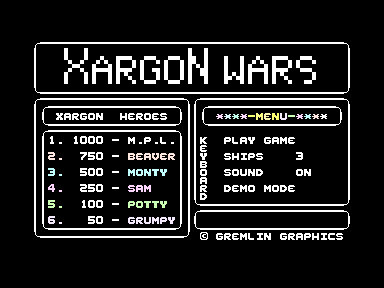

# Xargon Wars C16


This project reassembles the surviving **Xargon Wars** source for the Commodore 16 and Plus/4 with PlatformIO, VS Code and the cc65 toolchain. I wrote the game at Micro Projects, and Gremlin Graphics published it on cassette. The source carries the notice `(C) MICRO-PROJECTS LTD. 1985`, and the label on my source disk reads "completed 22/1/85".

Open the [complete HTML handbook](docs/XARGON_WARS.html) for the history, artwork, build guides, validation, code analysis, decoded graphics and reference in one offline document. It's generated from the Markdown files, which stay the source of truth. Run `make docs-html` after editing the docs, or `make docs` to refresh the build and analysis as well. [Maintaining the HTML Documentation](docs/HTML_DOCUMENTATION.md) has the details.


## Verified Build

The build matches **all 10,747 bytes recorded in the original `OBJ` object listing** with zero differences: the sixteen attack-wave tables, the program code and the initial values of the zero-page and page-3 variables. The complete PRG is 12,274 bytes. It loads at `$1010` and starts at `$1C80` (`SYS 7296`).

In VICE, on a PAL C16 with 16 KB RAM, the rebuilt game draws its title and menu, accepts the menu's PLAY GAME selection and runs the main game loop. I also have a running copy of the game, which is a slightly different revision. Assembling the source with two small edits in `ALIENS` reproduces every code byte of the running version, apart from 21 bytes that the program itself writes while it runs. That copy was saved after the game had already started. [Source and Validation](docs/SOURCE_AND_VALIDATION.md) has the full comparison.



---

## Build and Run

You need Python 3.9 or later and the cc65 tools (`ca65` and `ld65`), plus VICE (`xplus4`) to run the game. On macOS with Homebrew:

```sh
brew install cc65 vice
./build.sh
python3 scripts/run_vice.py
```

The output is `build/xargon-wars.prg`. It has no BASIC stub, so the launcher loads it at its saved address once the C16 has reset, then jumps to `$1C80`. `python3 scripts/run_vice.py --original` LOADs and RUNs my running copy through VICE autostart.

With PlatformIO Core, or from the PlatformIO terminal in VS Code:

```sh
pio run -e c16
pio run -e c16 -t upload
```

PlatformIO writes `build/platformio/c16/xargon-wars.prg`, and the upload target launches VICE. The `c16_debug` environment produces the same game bytes. The direct build also writes labels, a listing, a map and debug information. [Build and Run](docs/BUILD_AND_RUN.md) covers the VS Code tasks and the Makefile.

On the title screen, `J` selects the joystick (either port) and `K` the keyboard. The keys are `ESC` left, `1` right, `F3` up, `HELP` down and `F1` fire, as printed on the cassette inlay. The menu has PLAY GAME, SHIPS, SOUND and DEMO MODE. I haven't tested the keys or a joystick by hand yet.

---

## Preserved Inputs

`Original Source Recovered/2026/` holds the D64 image I captured in 2026 and its file-by-file extraction. Everything the build needs is on that disk. The build reads the D64 directly and checks each file against the extraction and its hashes. `Original Source Recovered/1992/` is an older PC export of the same disk, both as files and as the original PKZIP archive. It agrees with the D64 apart from letter case and line endings, so it acts as a cross-check rather than a fallback. `Original Artifacts/xargon_wars.prg` is the running game.

`Original Artifacts/` has the cassette inlay, the instruction card, a gameplay screenshot and a photo of my source disk. The [Artifact Catalogue](docs/ARTIFACTS.md) describes each one.

All generated files go into `build/`. The original inputs stay exactly as they were. The [Source Inventory](docs/SOURCE_INVENTORY.md) lists every file on the disk and says which ones the build uses.

---

## History and Recovery Background

The source header says the program was written by A.J. Clarke "with kind permission from John B Marshall". The title scroller thanks Matthew for the graphics and his help. See [History and Credits](docs/HISTORY_AND_CREDITS.md).

My companion [Dorks Dilemma C16 repository](https://github.com/anthonyjclarke/Dorks_Dilemma_C16) has the recovery story, my original development setup and the acknowledgements for the recovery tools, especially in its [History and Credits](https://github.com/anthonyjclarke/Dorks_Dilemma_C16/blob/main/docs/HISTORY_AND_CREDITS.md). This project reuses the build approach from that restoration and from Tycoon Tex, so I haven't repeated the story here.

---

## Learning, Modification, and Ports

The [Codebase Analysis](CODEBASE_ANALYSIS.md) explains how the game works: its states, the two interrupts, the 16 sheets and their patterns, collisions, scoring, sound and graphics, plus the two revision differences. Probes in VICE confirm its key rules. [Illustrated Graphics](docs/GRAPHICS.md) shows the aliens, formations, ship and title decoded from the original bytes. The [Porting Guide](docs/PORTING_GUIDE.md) separates the original behaviour from my proposals for derivatives and ports. The [generated code reference](docs/analysis/CODE_REFERENCE.md), [asset data](docs/analysis/asset-data.json) and decoded [graphics](docs/analysis/README.md) help with finding your way around the source.


---

## Tests and Sharing

```sh
make test
make verify
```

Eleven regression tests cover:

- the output hash and every object-listing byte;
- source selection and the 1992 cross-check;
- the two alternative assembly roots and the `SAVER` listing;
- asset provenance and the explanation of the running version;
- unchanged inputs, include failures, syntax conversion, and corrupt hex records or disk chains.

The VICE check covers the title, the scripted menu selection and gameplay entry. I still haven't played a full game, listened to the sound or tried real hardware. See [Testing](TESTING.md).

[Sharing on GitHub](docs/SHARING_ON_GITHUB.md) covers the repository and its tags. The historical notices are all still in place, and I haven't added a licence. See [Rights and Preservation](RIGHTS.md). Changes are recorded in the [Changelog](CHANGELOG.md).
