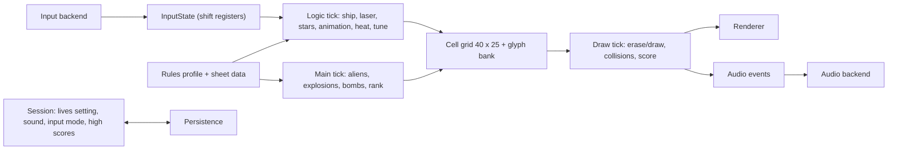

# Xargon Wars – Modification and Porting Guide

## What This Guide Provides

This guide is for anyone who wants to change Xargon Wars or rebuild it on another platform. It separates what the original actually does, as described in the [codebase analysis](../CODEBASE_ANALYSIS.md), from what I'm proposing for a new version. None of the architecture, interfaces, build targets or command-line options proposed here exists in this repository yet. The only supported build is the preservation build, which reproduces the `OBJ` listing.

The raw material for a port is already exported: [asset-data.json](analysis/asset-data.json) holds the character set, tune, sheet tables, patterns, formations and named tables; [codebase-index.json](analysis/codebase-index.json) holds symbols, byte ownership and write sites; and [rule-probes.json](analysis/rule-probes.json) records the confirmed arithmetic.

---

## Choose the Intended Compatibility Contract

There are three distinct kinds of new version, and each one needs a different promise:

| Kind                     | Keeps                      | Changes                  |
|:-------------------------|:---------------------------|:-------------------------|
| Same-platform derivative | 6502 code, TED, timing     | Chosen rules or content  |
| Emulator-hosted edition  | Original or derivative PRG | Packaging, input mapping |
| Native reimplementation  | Rules, data, presentation  | Code, timing model, I/O  |

A **same-platform derivative** edits the source and is rebuilt with the same pipeline. Examples are a fixed J/K selection, a pause key, or new sheets. It's still cycle-timed by the TED, so its feel is the original's unless you change it.

An **emulator-hosted edition** runs the PRG in VICE or another emulator inside a modern wrapper. Nothing about the rules changes, and the work is all in input mapping, display scaling, audio and distribution.

A **native reimplementation** rewrites the game, for example in C, Python or for a microcontroller. It has to translate every timing domain and decide every compatibility question in the table further down.

---

## Protect the Preservation Build

Keep the historical build exactly as it is. `scripts/restore_c16.py` must keep reproducing all 10,747 `OBJ` bytes and the PRG hash in `test/test_restoration.py`. Here's how I'd introduce a variant without disturbing that (all of this is proposed, none of it exists yet):

1. Work on a branch, and keep `main` and the published tags as the preservation baseline.
2. Put derivative source changes in a new folder, for example `variants/<name>/`, as edited copies or patch files. Never edit `Recovered Source/`.
3. Give the variant its own build entry point and output name, for example `build/variants/<name>/xargon-<name>.prg`. Its own tests should say exactly how it differs from the source revision.
4. Reuse the comparison approach in [compare_reference.py](../scripts/compare_reference.py): list each edit as module, line, original text and replacement, and check that the edit list explains every byte difference.
5. Add a PlatformIO environment or Make target for the variant only once it exists and has been tested.

`compare_reference.py` already does this once, for the running revision, in `build/running-variant/`. That's a comparison aid, not a supported target.

---

## Proposed Portable Architecture

These boundaries are proposals. None of them exists in the repository.



- `SessionState` holds the menu settings (`LIVES` 1–4, sound on or off, keyboard or joystick), the high-score table and the demo flag.
- `GameState` holds the sheet (play order and table index), level, the 32 alien records, 16 bombs, 16 stars, ship column, laser position and flags, heat, score, lives, the draw handshake flags and the random-number state.
- `CellGrid` is a 40×25 array of glyph codes and attributes, plus a 128-glyph bank that the animation rewrites. Keeping a cell grid at first is the easiest way to keep the collision rules (see below).
- `InputState` holds five 8-bit shift registers (left, right, up, down, fire) and a "moved" flag. The fire edge-detection and the demo both depend on that representation.
- `AudioEvent` carries laser start, overheat, alien hit, ship explosion and tune start (jingle or level tune), with per-frame update rules for each.

---

## Schedule the Three Timing Domains Separately

The original runs three kinds of work at different rates, and a port that updates everything once per frame will change how the game feels:

| Domain     | Original trigger              | Work                            |
|:-----------|:------------------------------|:--------------------------------|
| Draw tick  | Raster IRQ, line 210, 1/frame | Erase, draw, collide, sound     |
| Logic tick | Timer 2, measured 1/frame     | Input, ship, laser, stars, heat |
| Main pass  | Busy loop, about 3.2 frames   | Aliens, explosions, bombs, rank |

The measured figures come from [rule-probes.json](analysis/rule-probes.json): one VICE sample early in sheet 1. Interrupt load makes the main-pass length vary, so measure more before choosing a fixed rate. A conceptual scheduler (a proposal):

```text
each 1/50 s frame:
    logic tick   (input, ship move/fire, laser move, stars, heat, animation, tune)
    draw tick    (erase aliens, sound, draw aliens, bombs, laser + hit test, gauge, ship + hit test, death)
    every N frames (N measured, about 3.2): main pass
        rank; every MVESPD passes move aliens + explosions;
        every FRESPD passes new bomb; every BOMSPD passes move bombs;
        check game over / sheet clear
```

The logic tick also runs alien animation, side-panel colours and the tune.

Turn the busy-waits into states. `SHTOVR` waits for the hit sound and the death sequence, `NXLEVL` waits for the tune, and `NICSTR`, `KATH` and the title loop use delay loops. Each of these should become a state that keeps rendering and taking input.

---

## Translate Coordinates Without Losing the Rules

Keep the 40×25 cell grid as the simulation space. Aliens are 3×1 cells and take X from 1 to 29 and Y from 1 to 23, wrapping as described in the analysis. The ship is 3×3 cells, with its top glyph in the middle column, at rows 21–23 and columns 1–29. The laser is 1×1 and starts at the ship's middle column on row 20. Bombs are 1×1. The side panel occupies columns 33–39.

A higher-resolution renderer can draw the cells as sprites. The simulation should still work in cells: collisions read cell contents, and movement is one cell per step.

---

## Graphics, Text and Asset Extraction

Everything visual can be rebuilt from [asset-data.json](analysis/asset-data.json):

- `font` is the 1,024-byte `FRAK!` set at `$3C00`, 8 bytes per glyph.
- Each entry in `sheets` gives the colours, the 72-byte alien glyph block (frames at offsets 0, 24 and 48, played 0-1-2-1), the pattern and the formation.
- `tables` includes `EXPLAN` (explosion frames), `FICHAR` (bomb), `LACHAR` (laser), `STCOL`, `GACOUL`, `PLOXEL`, `TTB` and the title letter point lists.
- [graphics/ted-palette.json](analysis/graphics/ted-palette.json) is the 128-entry TED palette captured from VICE 3.10. Treat it as the emulator's rendering, not as measured hardware output.

Render a cell like this. If bit 3 of the attribute is set and multicolour mode is on, decode pixel pairs to background, `MULTI1`, `MULTI2` and the cell's colour (attribute AND `$77`). Otherwise draw hires in the cell's colour. [render_game_graphics.py](../scripts/render_game_graphics.py) is a working reference for that decoding.

Keep the runtime glyph changes as data: the alien and explosion frames, bomb and laser frames, the scroller borrowing glyphs 80–98, and the death sequence scrambling 80–86. Text is ASCII converted with `AND #$3F`. The scroller's glyph lookup only works for letters and space (see the analysis). The title is drawn as points on an 80×50 quarter-cell grid.

---

## Rules That Need an Explicit Compatibility Choice

| Behaviour                   | Original (source revision)             |
|:----------------------------|:---------------------------------------|
| Extra-life timing           | Paid on the hit after crossing 1,000   |
| Score past 99,999           | Wraps; stray glyph 1 at row 9, col 9   |
| J/K selection               | Reads an arbitrary keyboard row        |
| Fire while held             | Shift-register edge; a few early shots |
| Level bonus extra life      | Always, plus 200 points                |
| Difficulty after level 1    | Speeds − `LEVEL`, floor 1; 10 points   |
| Timer 2 versus raster       | Observed in step, mechanism unknown    |
| Both IRQs pending           | Only the timer work runs that entry    |
| Explosion appearance        | Global animation frame, not per alien  |
| Laser at an empty-match hit | Bolt removed even with no alien found  |
| Lives cap                   | 9 (`ADDLIF`)                           |
| Demo                        | Random sheet 1–8, runs to game over    |
| High scores                 | RAM only, lost at power-off            |
| `GIDO`/`BUMP` masks         | Source and running revisions differ    |

For each row, a faithful port keeps the original behaviour. A corrected derivative documents what it changes. A port to a different screen layout has to pick one of the two `ALIENS` mask revisions explicitly. They only behave the same because of the C16 screen address range.

---

## Hardware Responsibilities to Replace

| Original                        | Replacement in a port                     |
|:--------------------------------|:------------------------------------------|
| TED raster IRQ, timer 2         | Fixed-step scheduler (three domains)      |
| Character RAM at `$3C00`        | Mutable glyph bank or sprite atlas        |
| Screen and colour RAM           | Cell grid with attribute per cell         |
| `$FF16`/`$FF17` multicolour     | Per-sheet palette entries                 |
| Keyboard matrix `$FD30`/`$FF08` | Key mapping into the five shift registers |
| Joystick on `$FF08`             | Gamepad mapping, same registers           |
| TED tone and noise channels     | Two-voice synth or sampled effects        |
| Timer bytes as random numbers   | Seeded generator, recorded in traces      |
| KERNAL `$FFD2`, IRQ vectors     | Not needed                                |

The `RANDOM` routine is a 4-byte add-with-carry generator. `SETUP` seeds it by reading TED register `$FF0B` four times, and the source comment calls that "TIMERS AS RND #". Alongside it, the TED timer bytes are read directly for the star X positions, bomb colours, the demo's starting sheet and direction, and the title delay. For repeatable tests, a port should seed the generator once and log every draw, rather than reading a host clock.

---

## Recommended First Playable Slice

Start with a single sheet, sheet 1 (table 0): 24 aliens, a one-step pattern moving right, multicolour.

1. Load `font` and the sheet entry from `asset-data.json`, and draw the static play screen and side panel from `TEXT`.
2. Implement the logic tick (input shift registers, ship movement, laser movement, heat and gauge) and the draw tick (alien erase and draw, the laser hit test, `SCORE` at level 0).
3. Add the main pass with `MVEALL` and `UPEXPL`, then bombs (`NEWBMB`, `MVEBMB`, `PRBOMB`), then the ship hit test and death.
4. Compare against the original in VICE: the alien positions after N main passes, the score after scripted hits, and heat over a fixed firing sequence.

Then add the other 15 sheets with `CONSHT` ordering, `SHTOVR`, `NXLEVL` and `LEVINC`. After that come the title, menu, high scores, demo, sound and tunes.

---

## Suggested Development Milestones

1. **Data loader.** Parse `asset-data.json`, render every glyph and sheet, and match the figures in the analysis.
2. **Static screens.** The play screen and title layout match the verified screenshots cell for cell.
3. **Sheet 1 slice.** The ship, laser, heat, aliens, hits and score match VICE traces.
4. **Full sheet set.** All 16 sheets in play order, sheet clear, level advance and difficulty.
5. **Bombs and death.** Bomb timing, collision rules, the death sequence, lives and game over.
6. **Front end.** Title, menu, scroller, high-score entry, rank and demo.
7. **Audio.** Effects and both tunes from the tune table.
8. **Options.** Each compatibility choice from the table above as a named profile.

---

## Trace and Fixture Formats

These formats are proposals. A useful trace is one JSON line per main pass, or per frame, holding:

- the pass or frame number and the sheet, level and score;
- the alien records (X, Y, pattern index, flags) and the bomb slots;
- the ship column, laser position, heat and lives;
- the five input registers and the random-number state.

VICE can produce matching traces from the original. Break at `START` (`$25D6`) or `TIMER2` (`$2689`) and `bsave` the state regions (`$0002–$002D`, `$033C–$03B2`, `$0400–$075F` and the score cells at `$0C72`). That's the same technique [verify_vice.py](../scripts/verify_vice.py) and [probe_gameplay_rules.py](../scripts/probe_gameplay_rules.py) use.

Fixtures for routine tests can reuse the probe pattern: set the RAM state, call one routine, compare the memory afterwards. The existing probes already cover `SCORE`, `XTRALI`, the overflow, `LEVINC` and the observed interrupt and loop periods.

---

## Conformance and Regression Test Plan

| Test                         | Compared against                     |
|:-----------------------------|:-------------------------------------|
| Glyph and sheet decoding     | `asset-data.json`, analysis figures  |
| Points, extra life, overflow | `rule-probes.json`                   |
| Level speed reduction        | `rule-probes.json` (`LEVINC`)        |
| Alien movement and wrap      | VICE traces at `START`, per sheet    |
| Laser hit identification     | VICE traces with scripted fire       |
| Bomb spawn and ship death    | VICE traces with a fixed random seed |
| Sheet clear and level bonus  | VICE trace through sheet 16          |
| Title and menu layout        | `docs/images/restored-title.png`     |
| Play screen layout           | `docs/images/restored-gameplay.png`  |

Random draws come from both the generator and the TED timers. Exact trace equality therefore needs either an emulator-hosted reference with the same inputs or a port that accepts recorded random values.

---

## Open Work Before a Complete Port

Several things still have to be measured or confirmed before a native port can claim full fidelity:

- the main-pass length across sheets and loads, and why timer 2 stays in step with the raster;
- manual play with a keyboard and a joystick, including whether J/K selection works on real hardware;
- audio recordings, to compare against a synthesised version;
- a complete play-through, including level 2 and score overflow in practice;
- testing on a real C16 or Plus/4.

The analysis lists the open questions in [Verified Findings](../CODEBASE_ANALYSIS.md#verified-findings-open-questions-and-next-experiments).
