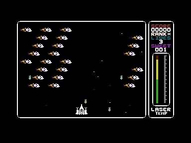
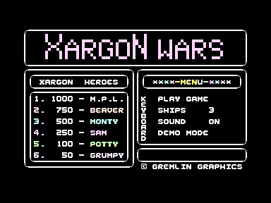

# Source and Validation

## Result – 20 October 2026

The rebuilt PRG holds 12,272 memory bytes from `$1010` to `$3FFF`, plus a two-byte load address. It starts at `$1C80` on a 16 KB PAL C16.

| Measurement                    | Result                      |
|:-------------------------------|:----------------------------|
| Complete PRG                   | 12,274 bytes                |
| Sheet tables `$1010–$1B01`     | 2,802 bytes                 |
| Program code `$1C80–$3AE5`     | 7,782 bytes                 |
| Zero-page and page-3 variables | 44 + 119 bytes (not in PRG) |
| Object-listing bytes           | 10,747                      |
| Object-listing differences     | 0                           |
| Regression tests               | 11 passing                  |
| Emulator                       | VICE 3.10, PAL C16, 16 KB   |

The verified output SHA-256 is:

```text
6b766dcd2c6abbcd47e29ed005d72c0f1c28dc1f95aa1186c11ffe972a1e5daf
```

The running PRG I have hashes to:

```text
835d26e3b92c91f720b0bf3444c0127f9e66e896608d72ef32cf2b186fb69cec
```

The evidence for this checkpoint is the [build comparison](verification/build-comparison.json), the [running-version comparison](verification/reference-comparison.json), the [VICE report](verification/vice-verification.json), the [source manifest](verification/source-manifest.json) and the [tool checks](verification/tool-checks.json). Each new build writes fresh reports to its output directory.

---

## Source Selection and Assembly

The 2026 D64 is complete, so no fallback is needed. The build reads all 77 directory entries straight from the image, and each one matches the 2026 extraction byte for byte and its recorded hash. The 1992 export is a copy of the same disk. All 60 of its source and listing text files match after converting lower case to upper case and CRLF to CR, its ten `.BIN` files are identical, and the PKZIP archive's directory agrees with the extracted folder. The [Source Inventory](SOURCE_INVENTORY.md) lists everything.

`ULTRA` is the root. The build expands its 50 `.LIB` includes in their original order, and each must resolve to exactly one disk file. The syntax converter keeps these exactly as written:

- instructions and operands;
- equates and literal strings;
- the two macros, `SAVE` and `LOAD`;
- self-modifying operands;
- reservations made with `*=*+n`.

There's one adaptation. `SHTABLE` defines the label `SHTABL` at `$1010`, and `MAIN-VARS` later repeats it as an equate, `SHTABL = $1010`. The original assembler accepted the repeat, but ca65 doesn't. The converter turns the repeat into an `.assert` that fails the build if the two values ever differ.

`OBJ` is a MOS Technology hex-format listing. The build validates each record's length and checksum and the final record count before comparing anything. All 10,747 bytes it records match the assembly. That covers the sheet tables, the code, and the initial values of the variables in zero page (`$0002–$002D`) and page 3 (`$033C–$03B2`). The variable areas aren't part of the PRG, because the program sets them itself when it starts. The build writes them to `zeropage.bin` and `page3.bin` only so they can be checked.

`LISTER` (the same root with the listing switched on) and `ASSEM-SHEETS` (the sheets alone) also assemble to the same bytes. `SAVER` assembles to its own listing, `OBJ.ANT`, except for one operand.

### Memory Layout

| Address range | Content                             |
|:--------------|:------------------------------------|
| `$0002–$002D` | Zero-page variables (`VARS`)        |
| `$033C–$03B2` | Page-3 variables (`VARS`)           |
| `$0400–$045F` | Alien table, 32 × 3 bytes           |
| `$0560–$075F` | Bomb, star, scroll and alien tables |
| `$0800–$0BFF` | Colour RAM (TED attributes)         |
| `$0C00–$0FE7` | Screen RAM                          |
| `$1010–$1B01` | `SHTABLE` and the 16 sheets         |
| `$1B02–$1BFF` | Unused, zero in the PRG             |
| `$1C00–$1C7F` | Tune table from `MUSIC/CODE`        |
| `$1C80–$3AE5` | Program code and data               |
| `$3AE6–$3BFF` | Unused, zero in the PRG             |
| `$3C00–$3FFF` | Character set from `FRAK!`          |

Only the regions from `$1010` upwards are written to the PRG. The linker configuration is [config/c16.cfg](../config/c16.cfg).

---

## Graphics and Tune Provenance

The character set is the surviving 1,026-byte `FRAK!` file, including its `$3C00` load address. The source names it directly: "JUST LOAD ON 'FRAK!' ON THE C16 / IT HAS ALL THE GRAPHICS". The program changes some glyphs while it runs, for the stars, the scroller and the alien animation, so the file is the starting state rather than what's on screen at any moment. `CAMEL (CHARS)` is an earlier set that differs in 14 glyphs, and `MEGA-SUPER` is a different set altogether. Both are kept, and neither is used.

The tune table at `$1C00` is the 128-byte `MUSIC/CODE` file. `MAIN-VARS` sets `TUNDAT=$1C00` and labels it "TUNE DATA FOR BOTH TUNES". `GLOPPY (MUSIC)` holds the same 128 bytes saved at `$1E80`.

No executable or graphics bytes come from the running PRG.

---

## Comparison with the Running Version

The running PRG isn't compressed. It's a BASIC line `1 SYS7296` followed by memory from `$1010` to `$3FFE`. Since both files are saved-address memory images, their memory can be compared directly.

| Region               | Bytes | Different | Explanation                      |
|:---------------------|------:|----------:|:---------------------------------|
| `$1001–$100F` BASIC  |    15 |         – | Only in the running PRG          |
| `$1010–$1B01` sheets | 2,802 |         0 | Identical                        |
| `$1B02–$1BFF` gap    |   254 |       128 | Running PRG has `$00`/`$FF` fill |
| `$1C00–$1C7F` tune   |   128 |         0 | Identical                        |
| `$1C80–$3AE5` code   | 7,782 |     3,442 | Two edits, shift, runtime state  |
| `$3AE6–$3BFF` after  |   282 |       260 | Leftover bytes, see below        |
| `$3C00–$3FFE` font   | 1,023 |         8 | Glyphs 125 and 126               |

### The Two Revisions

The 3,442 raw code differences come from two small source changes in `ALIENS`, plus everything that moves when code shifts by six bytes:

| Source line               | Source revision               | Running revision |
|:--------------------------|:------------------------------|:-----------------|
| `ALIENS:150–152` (`GIDO`) | `LDA IH`, `AND #$F`, `STA IH` | absent           |
| `ALIENS:227` (`BUMP`)     | `AND #$0F`                    | `AND #$7F`       |

[scripts/compare_reference.py](../scripts/compare_reference.py) applies exactly those edits to the source and assembles the result separately. Afterwards, 21 code bytes still differ, and each one is a location the program writes as it runs. The script names the writing instruction for each:

| Symbol                         | Source  | Running | Written by               |
|:-------------------------------|:--------|:--------|:-------------------------|
| `LIVES`, `CFLAG`               | `00 00` | `03 01` | Start-up code at `$1C80` |
| `DELAY+1`                      | `00`    | `0C`    | Title loop, random delay |
| `PXL`, `PXL1`, `PXLL` operands | `$22E6` | `$3217` | `PRMENU` text pointer    |
| `TITCOL`                       | `71`    | `74`    | Title colour cycling     |
| `CSOU+10..12`                  | `ON `   | ` ON`   | `SESOUN` sound label     |
| `CHZ` (8 bytes)                | zeros   | `6D–74` | `PRBOX` frame characters |

That's the evidence that the running PRG was saved from memory after the game had started. VICE confirms it: when the running PRG is autostarted and stopped at its title loop, 19 of those 21 bytes already hold the snapshot's values. The other two are a random delay and a cycling colour, which change on every pass.

In both revisions, the two `ALIENS` changes strip flag bits from the high byte of an alien's screen address. `ALIPRT` stores that byte with bit 7 marking an explosion. `RUSTIC` only produces addresses from `$0C00` to `$0FE7`, so the high byte is always `$0C`–`$0F` plus that flag. For those values, `AND #$0F` and `AND #$7F` give the same result, and the extra `GIDO` mask changes nothing. I've worked that out by reading the code, and haven't probed it. The [codebase analysis](../CODEBASE_ANALYSIS.md#revision-differences) explains the address format. I can't tell from the evidence which revision is later. The source carries the stricter masks, and it's the revision the `OBJ` listing records, so that's the one the default build reproduces.

### Bytes After the Code

The running version's code ends at `$3ADF`. From `$3AE0` to `$3B6C` there are 132 bytes that aren't fill. The first 12 repeat the end of the `KEYBOARD`/`JOYSTICK` strings, 12 bytes further on than this revision puts them. What follows is a keyboard-scanning routine with 16-entry key tables. It stores the key number at `$1C95`, which is `SHEETN` in this layout, and a second short routine waits on a key. It looks like a version of the commented-out `HAK/SCREEN` cheat, though the code isn't the same as the surviving `HAK/SCREEN` text. I think these bytes were left in memory by an earlier, longer assembly, before the running copy was saved. That's an inference: nothing calls them in either revision, and the build doesn't reproduce them.

### Character Set

The running PRG differs from `FRAK!` at `$3FED–$3FF4`, which is the last three bytes of glyph 125 and the first five of glyph 126. The disk file has `01 47 31 32 32 37 37 05` there, and the running copy has `40 58 41 52 47 4F 4E 06`. Read as ASCII, those are `.G122775.` and `@XARGON.`, which look more like stray text than glyph shapes. Neither glyph appears on screen in the title or gameplay captures, and the code never refers to them. The running PRG stops at `$3FFE`, so `$3FFF` isn't in it.

---

## Emulator Evidence and Limits

VICE draws the title and menu, and runs the normal initialization, the star start-up and the "ARE YOU READY ? / GO FOR IT !" countdown. The script stops right after the menu's own joystick read, sets the result flags for fire with the box on PLAY GAME, and resumes. The original code reaches `START` at `$25D6` with `PLAYIN = 1`, `GLIVES = 3` and `SHEETN = 0`, and runs 100 more loop passes. No instructions are patched.




The running PRG, autostarted with LOAD and RUN, reaches the same title:



I've checked the screenshots by eye against the archived gameplay screenshot and the cassette inlay. The tests show that the game renders and starts gameplay from scripted input. I haven't verified manual keyboard mapping, joystick operation, sound, collisions, scoring over a full game, wave transitions, death, high-score entry or a complete play-through, and I haven't run it on a physical C16 or Plus/4.

---

## Continuous Integration

GitHub Actions runs the workflow on Ubuntu with the distribution's cc65 package. For the `v1.0.0` commit `a75d53c`, run [39391718258](https://github.com/anthonyjclarke/Xargon_Wars_C16/actions/runs/39391718258) on `main` and the tag's own run both passed. That covered the build, the running-version comparison, the regression tests, both PlatformIO environments and the byte comparison. CI doesn't run VICE, so the emulator evidence above comes from my local runs only. Later results are on the [Actions page](https://github.com/anthonyjclarke/Xargon_Wars_C16/actions).

---

## Recovery Background

My original development environment and the disk and source recovery are covered in [Dorks Dilemma C16](https://github.com/anthonyjclarke/Dorks_Dilemma_C16) and its [History and Credits](https://github.com/anthonyjclarke/Dorks_Dilemma_C16/blob/main/docs/HISTORY_AND_CREDITS.md). This document sticks to Xargon Wars' own inputs, build and validation.
